  

  <a href="https://vigneshwaran-r.vercel.app"><b>Portfolio</b></a> &nbsp;·&nbsp;
  <a href="https://www.linkedin.com/in/vigneshwaran-r-216501301">LinkedIn</a> &nbsp;·&nbsp;
  <a href="mailto:vigneshwaranr985@gmail.com">Email</a> &nbsp;·&nbsp;
  <a href="https://vigneshwaran-r.vercel.app/resume.pdf">Resume</a>

  

### Shipped

**Go-Park** — multi-tenant parking and gate platform. One FastAPI + PostgreSQL backend with row-level security, serving an offline-first gate controller for RFID barriers and ANPR cameras, Android apps for guards and residents, and admin web portals.

**DocRepo** — AI knowledge repository. Ingests PDF, Word and Excel (OCR for scans), files them automatically, and answers questions with a RAG assistant that only speaks from what's stored.

**DataOps** — automated ELT pipeline. Validates every load and turns each violation into a severity-scored ticket, with live dashboards.

These are company products, so the code stays private. The [portfolio](https://vigneshwaran-r.vercel.app) walks through each one, animated.

The terminal above refreshes itself daily through a GitHub Action in this repo. The barrier, unlike most, always opens.
